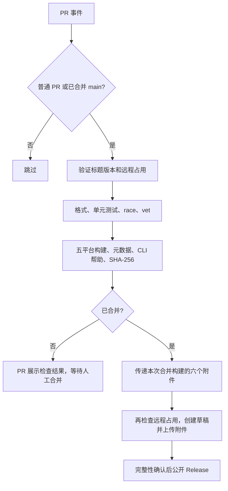

## 概览

**目的**：PR 标题填写版本号 → 检查通过 → 人工审核合并 → 自动发布。

对应唯一[工作流](<../.github/workflows/ci.yml>)；全部发布逻辑在工作流内，无版本文件、独立程序、发布脚本或额外发布工具。

| 事件 | 条件 | 行为 |
| --- | --- | --- |
| PR 创建、标题/元数据编辑、提交更新、重新打开、转为待审核 | 目标 main | 版本检查、项目测试、五平台交叉编译；不发布 |
| PR 关闭 | 已合并 main | 对准确合并源码重新执行全部检查，再发布 |
| PR 未合并关闭、直接 push、标签 push | 任意 | 不发布 |

## 执行流程

| Job | 目的 | 依赖 | 环境 / 超时 |
| --- | --- | --- | --- |
| Version, tests and build | 校验版本、源码与全部产物 | 合格事件 | Linux x64 / 30 分钟 |
| Publish merged PR | 只发布准确合并提交的完整附件 | 前一个 Job 成功，且已合并 main | Linux x64 / 10 分钟 |

普通 PR 使用测试合并提交；合并事件检出实际最终合并 SHA，并确认属于 main 历史。发布复用同一次运行的已验证产物，不从旧 PR 运行或外部下载产物。

## 版本契约与输入

- 正式版本记录为 Git Tag；标题只提供输入，例如 `[v0.1.0-beta.3] 添加自动发布功能`。
- 标题必须以 `[vX.Y.Z] 描述` 或 `[vX.Y.Z-prerelease] 描述` 开始；必须有非空描述。
- 使用 SemVer：无数值前导零，预发布标识符允许字母、数字、连字符和点；不使用构建元数据。
- 已存在 Git Tag、已发布 Release 或可见草稿均占用版本；查询必须覆盖全部分页，查询错误导致失败。
- 已撤回且删除的历史 `v0.1.0` 明确永久禁止复用；保留模块文件的撤回声明，不通过它维护当前版本或解析版本历史。
- 不修改历史标签，不自动计算下一个版本；开发者自行选择符合 SemVer 习惯的新版本。
- 发布前再次检查占用。成功发布后重跑会失败，不覆盖或追加附件。
- 预发布后缀（包括 beta、rc）标记为 Pre-release，其他为正式 Release。
- 发布命令处理标签创建，指向实际合并提交；不另建标签管理流程。

## 输出与产物契约

| 目标 | 原生可执行文件 |
| --- | --- |
| darwin/arm64 | `skillscli_darwin_arm64` |
| windows/amd64 | `skillscli_windows_amd64.exe` |
| windows/arm64 | `skillscli_windows_arm64.exe` |
| linux/amd64 | `skillscli_linux_amd64` |
| linux/arm64 | `skillscli_linux_arm64` |

- 第六个附件 `checksums.txt`：恰好五行 SHA-256，使用原始附件名称。
- 使用 Go 原生交叉编译，禁用 CGO、移除构建路径；不发布压缩包、不支持 macOS Intel。
- 每个文件必须非空，检查文件格式与目标 GOOS / GOARCH / CGO 元数据；清单逐项回读验证。
- CI 原生执行 Linux x64 的 CLI 帮助；其他目标为编译检查，不宣称已运行其平台测试。
- 普通 PR 无持久发布附件；合并运行的临时 CI 产物只保留一天，用于两个 Job 间传输。下载后再次验证 SHA-256。
- PR 输出：具名状态检查、版本错误注解及步骤摘要；发布输出：完整 Release、自动发布说明、标签和摘要链接。

## 功能、安全与门禁

| ID | 要求 | 验收约束 |
| --- | --- | --- |
| REQ-001 | 人工合并前确认版本与构建 | main 设置 Version, tests and build 必需检查；要求分支最新 |
| REQ-002 | 失败不能公开不完整 Release | 所有测试和五个构建先完成；附件数量为六才公开草稿 |
| REQ-003 | 仅真实合并触发 | 未合并关闭或普通 PR 的发布 Job 跳过 |
| SEC-001 | 最小权限 | 检查 Job 只读；只有合并后的发布 Job 具有 contents 写权限 |
| SEC-002 | 无未合并代码提权 | 合并事件使用 main 上受信工作流，绝不检出未合并 head |
| SEC-003 | 输入不执行为代码 | PR 标题作为环境数据解析；不插入 Shell 程序正文 |
| SEC-004 | 凭证与依赖 | 自动 GITHUB_TOKEN，无 PAT/额外 secrets；不保留 Git 凭证；官方 Actions 固定提交，合并检查不使用构建缓存 |

没有自动合并、手动发布入口、标签推送触发器、额外发布审批或外部监控。网络依赖为 GitHub Git / Releases / CI 产物接口及 Go 模块下载。

## 并发、失败与恢复

- 同一 PR 的普通检查取消过时运行；发布与普通检查隔离，同一 PR 发布串行且不主动取消。
- 不用仓库全局单一 pending 槽，避免连续合并丢失触发。
- 格式、版本占用、远程查询、测试、构建或校验失败，保留原始日志并停止。
- 上传失败可能留草稿；维护者先检查是否实际已发布，确认未发布后再人工处理残留并重跑；流程不自动删除标签或 Release。
- 实际已发布版本不能通过重跑覆盖。GitHub Actions 保存日志、摘要与失败通知，不增加额外性能指标或覆盖率门槛。

## 验证与维护

| 场景 | 验证结果要求 |
| --- | --- |
| 正式、beta、rc 标题 | 合法且未占用时通过；正确区分 Pre-release |
| 缺少版本、空描述、错误 SemVer、前导零、构建元数据 | 明确失败 |
| 已撤回 v0.1.0、已有标签、Release/草稿、网络异常 | 失败且没有远程写入 |
| 修改标题、更新提交 | 自动重新检查，不依赖修改路径 |
| 未合并关闭、普通 PR | 不运行发布 |
| 构建、下载校验、上传或附件数量失败 | 不公开 Release |

验收包括 Go 测试、race、vet、五平台编译/文件格式/元数据/SHA-256、可运行平台 CLI 帮助、工作流静态检查及隔离发布保护模拟。真实发布仅在维护者合并后验证，不为测试提前发布。

改变版本输入、事件、权限或附件时，同步更新本规范、README 和工作流，在 PR 验证后人工合并。用户安装说明见 [README](<../README.md#安装与前提>)。
