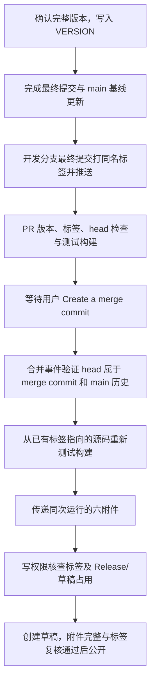

## 概览

**目的**：人工确认完整版本并写入 VERSION → 开发分支最终提交打同名标签 → PR 检查 → 手动保留提交合并 main → 自动使用已有标签构建发布。

对应唯一[工作流](<../.github/workflows/ci.yml>)；不新增独立 Go/Shell 版本或发布程序。[发布 Skill](<../.agents/skills/release-skillscli/SKILL.md>) 只准备版本、最终提交标签与 PR，或只读跟踪发布；不自动生成版本、不合并、不直接发布。

| 事件 | 条件 | 行为 |
| --- | --- | --- |
| PR 创建、更新提交、重新打开、转为待审核 | 目标 main | VERSION/tag/head 一致性、测试、五平台构建；不发布 |
| PR 关闭 | 已手动合并到 main | 验证标签提交保留在 main 历史，重新测试构建已有标签并发布 |
| PR 未合并关闭、标题编辑、分支 push、标签 push/删除 | 任意 | 不发布；不从标题读取版本 |

## 执行流程与 Job

| Job | 目的 | 条件 / 依赖 | 环境 / 超时 |
| --- | --- | --- | --- |
| Version, tests and build | 版本与源码一致性、测试与产物门禁 | PR；合并事件另外校验历史归属 | Linux x64 / 30 分钟 |
| Publish tagged version | 使用已存在标签发布完整附件 | 合并事件且前一个 Job 成功 | Linux x64 / 10 分钟 |

普通 PR 测试合并结果，同时要求其中 VERSION 与 PR head 的文件一致、同名标签指向 head。合并事件先确认标签 commit 等于事件最终 head、head 是实际 merge commit 的祖先且 merge commit 位于 main 历史，再测试构建标签源码；不构建新 merge commit 或后来 main tip。发布 Job 仅消费同次受信运行的附件，不执行仓库源码。

## 版本与输入契约

- [VERSION](<../VERSION>) 是源码构建版本，保存一行完整 `vX.Y.Z[-prerelease]`、行尾 LF；不允许构建元数据、core/预发布数值标识符前导零。
- VERSION、开发分支最终提交上的 Git Tag 名称、`skillscli -v / --version` 输出三者一致；参数只输出完整版本号及换行。
- [main.go](<../main.go>) 使用 Go 原生 `go:embed`，编译期包含 VERSION；直接构建与 CI 共用，不使用版本链接参数，不依赖运行期外部文件或 Git。五平台产物版本均与对应 Release 标签一致。
- 版本必须由用户明确指定/确认；工作流和 Skill 不从 PR 标题获取，不自动生成或递增版本。保留模块撤回声明，`v0.1.0` 永久禁用；v2 及以上需核对 Go 模块路径兼容要求。
- 同名标签必须已存在并指向 PR 最终 head，允许普通标签和直接指向 commit 的 annotated tag；缺失、错名、指向旧提交均阻塞。
- 打标签前必须完成所有提交与 main 基线更新；打标签后不能再提交。需要继续修改时由用户决定新的未占用版本，不能移动/覆盖旧标签或自动换号。
- 使用 **Create a merge commit** 人工合并，禁止 Squash/Rebase 丢失标签提交。标签指向被保留的 head，不是新 merge commit；不能用合并后重新打标签修复。
- CI 不创建、移动、覆盖或删除标签。只有 Skill/维护者准备 PR 时创建该版本唯一同名标签；已有同名同 SHA 标签仅复用。
- 内容写权限的发布 Job 对全部分页 Release/草稿做唯一权威占用检查，查询错误或已占用即停止；不在 PR 检查重复调用 PR/Release API。
- 预发布后缀自动标记 Pre-release，正式版无后缀。

## 输出与产物

| 目标 | 原生可执行文件 |
| --- | --- |
| darwin/arm64 | `skillscli_darwin_arm64` |
| windows/amd64 | `skillscli_windows_amd64.exe` |
| windows/arm64 | `skillscli_windows_arm64.exe` |
| linux/amd64 | `skillscli_linux_amd64` |
| linux/arm64 | `skillscli_linux_arm64` |

第六附件为 `checksums.txt`，恰好五行 SHA-256，逐项回读。禁用 CGO、移除构建路径；检查文件非空及 GOOS/GOARCH/CGO 元数据。不压缩，无 macOS Intel 产物。Linux x64 原生校验两个版本参数等于标签；其余平台仅交叉编译，共用同一嵌入版本来源，不冒称原生运行测试通过。

PR 不上传持久发布产物；合并事件的临时附件保留一天，仅在同次运行中传递。下载后再次验证校验和，上传后的六附件名称、数量与大小必须和本地文件相同，且远程标签 SHA 复核通过，才公开草稿。日志、版本/head 摘要和最终 Release 链接作为审计输出。

## 功能、安全和门禁

| ID | 要求 | 验收 |
| --- | --- | --- |
| REQ-001 | 三方版本一致 | VERSION 等于标签名，标签指向最终 PR head，程序两个版本参数与其一致 |
| REQ-002 | 仅手动合并后发布 | 未合并 PR 和标签 push 均不发布；标签提交进入 main 历史 |
| REQ-003 | 完整发布 | 测试、构建、校验和、附件清单与标签复核通过才公开 |
| SEC-001 | 最小权限 | 默认只读 contents，只有发布 Job 可写；不持有 PAT 或额外 secrets |
| SEC-002 | 受信发布 | 合并事件使用 main 的受信工作流，执行源码前校验历史归属；写权限 Job 不检出或执行仓库源码 |
| SEC-003 | 输入不执行为代码 | 事件 SHA 和版本通过环境变量/文件传入，合法版本先校验，不插入 Shell 正文 |
| SEC-004 | 不重用或移动版本 | Release/草稿占用和 API 错误阻塞；上传前及公开前复核远程标签 commit |
| SEC-005 | 凭证与依赖 | checkout 不保留凭证，官方 Actions 固定提交，不使用构建缓存 |
| SEC-006 | 保护规则不降低 | main 必需检查名称及分支最新要求不变，不擅自改规则或开启自动合并 |

仓库应限制为保留原始提交的 merge 方式；若远端仍允许 Squash/Rebase，发布也必须验证实际历史并失败关闭。推标签前确认仓库不存在其他标签触发发布流程，防止提前发布。本工作流不增加手动发布入口或修改仓库规则。

## 并发、失败与恢复

- 同一 PR 的过时检查会取消；合并发布按 PR 隔离、不取消进行中的发布。
- 错误版本、标签缺失/错误 SHA、未保留 head、测试/构建/校验失败均停止；不降低门槛、不换版本掩盖错误。
- 远程查询失败、标签移动/删除、Release/草稿占用、附件异常阻止公开；上传失败可能残留草稿，由维护者核对原始错误后处理，不自动删除、覆盖或重发。
- 发布前两次标签复核仍存在 API 调用间的竞态窗口；标签永久不可变还需远端标签保护，不擅自修改此类规则。
- 已公开或已有草稿的版本重跑会阻塞。标签存在是必需条件，不当成版本冲突；缺失时不能让 Release API 自动创建。

## 验证与维护

| 场景 | 预期 |
| --- | --- |
| 普通 PR 标题无版本，VERSION/tag/head 匹配 | 测试构建，不发布 |
| 合法正式/beta/rc 版本 | 格式与标签一致性通过，发布时正确设置 Pre-release |
| 缺 VERSION、两段版本、前导零、元数据、撤回版本 | 阻塞 |
| 同名标签缺失、指向旧提交、只有其他名称标签 | 阻塞 |
| merge commit 保留最终 head | 标签提交进入 main 历史后可发布 |
| Squash/Rebase 丢失最终 head | 不发布；不能移动标签补救 |
| 无运行期 VERSION/Git，直接构建后运行 | 两个版本参数正确且不写运行数据 |
| Release/草稿占用、API 错误、标签移动/删除 | 阻塞，不覆盖 |
| 校验和、附件名称/数量/大小异常 | 不公开草稿 |
| Skill 版本未指定、仅查询状态 | 先询问完整版本，或只读查询；不自动计算/推标签 |

验收包括直接构建版本回归、单元测试/race/vet、五平台编译、工作流/Shell 静态检查及隔离 Git/发布保护模拟。真实发布只有用户手动合并后发生，不为测试提前合并或发布。改变事件、版本、权限或附件时同步维护本规范、[README](<../README.md#版本与自动发布>)、Skill 与工作流。
