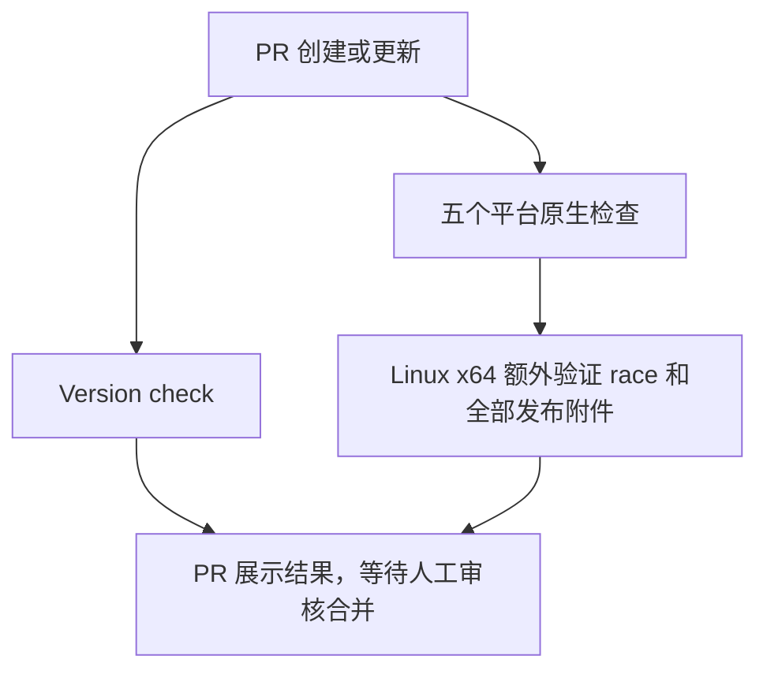

## 目的与触发

- 目的：在人工合并前展示版本、测试和构建结果；绝不创建标签或 Release。
- 实现：[PR 工作流](<../.github/workflows/ci.yml>)。
- 触发：目标为 `main` 的 PR 创建、提交更新、重新打开或转为待审核；不按修改路径过滤，草稿 PR 也检查。
- 同一 PR 新提交取消过时检查。

## 执行流程

| Job | 内容 | 环境 / 依赖 | 超时 |
| --- | --- | --- | --- |
| Version check | 版本格式、相对 main 更新、远程占用检查 | Linux x64；无需 Go；独立执行 | 10 分钟 |
| Checks（平台矩阵） | 格式、单元测试、vet、原生编译、CLI 帮助 | 五个平台；各自独立，不因其他平台失败而取消 | 每平台 20 分钟 |

平台为 macOS ARM64、Windows x64 / ARM64、Linux x64 / ARM64。使用 GitHub 托管原生 runner，先确认 Go 目标架构与平台匹配；不支持 macOS Intel。Linux x64 还执行 race 测试及[五平台附件与校验检查](<spec-process-cicd-release.md#构建与输出契约>)。

## 版本规则与输入输出

- 输入：根目录 [VERSION](<../VERSION>)、当前 PR 的测试合并提交、检出时的 `main`、远程 Git 标签和全部分页 Releases（包括可见草稿）。
- 格式：`X.Y.Z` 或 `X.Y.Z-prerelease`，无 `v` 前缀、空白、构建元数据；数值部分无前导零，预发布标识符遵循 SemVer。
- 必须与 `main` 中版本不同；首次引入文件时允许基线不存在。
- `v<VERSION>` 不能是任何已有标签或 Release 的版本；查询失败必须导致检查失败。
- 不计算递增、不比较历史版本大小、不解析模块撤回记录、不维护历史黑名单；开发者自行选择符合正常 SemVer 习惯的新版本。
- 输出：PR 中的 `Version check` 状态、错误注解、工作流摘要及平台检查状态；无持久发布产物。
- 本次首次迁移使用 `0.1.0-beta.3`，避开已查询到的 beta.1 / beta.2；后续不在工作流中硬编码版本。

## 安全与质量门禁

| 要求 | 约束 / 验收 |
| --- | --- |
| 最小权限 | 自动提供的 `GITHUB_TOKEN` 仅 `contents: read`；版本查询步骤使用此 token，无额外 secrets |
| PR 不发布 | 无写权限、无发布步骤；不使用有写权限的 PR 检查事件 |
| 凭证与依赖 | 不保留 Git 凭证；官方 Actions 固定提交；版本检查只用 runner 自带 Bash、Git、gh |
| 必需检查 | main 规则应要求 Version check 及五个平台 Checks，并要求合并前分支保持最新 |
| 人工控制 | 必须人工审核并手动合并；工作流不合并 PR |

## 失败、边界与验证

| 场景 | 预期 |
| --- | --- |
| 版本不变、格式不合法、已有标签或 Release | Version check 失败，显示具体原因 |
| Git / API 查询异常 | 失败，不将异常当作“版本未占用” |
| 单元测试、vet、格式或构建失败 | 对应平台失败；保留其他平台结果 |
| 权限 / 符号链接等平台条件 | 沿用现有测试跳过规则，日志如实记录 |
| main 更新 | 严格必需检查要求更新 PR 并重新检查，防止旧版本基线过时 |

验证：工作流静态语法检查；内联 Shell 的合法/非法版本、不变、标签与 Release 占用、网络失败场景；项目单元测试和 vet；五平台实际 CI 原生编译与 `--help`；全部附件及 SHA-256 清单。日志和摘要由 GitHub Actions 保存，不增加监控系统或覆盖率门槛。

## 维护

修改触发、版本规则、平台或权限时，同步修改本规范与实际工作流，通过 PR 检查后由维护者合并。相关规范：[合并发布](<spec-process-cicd-release.md>)。
