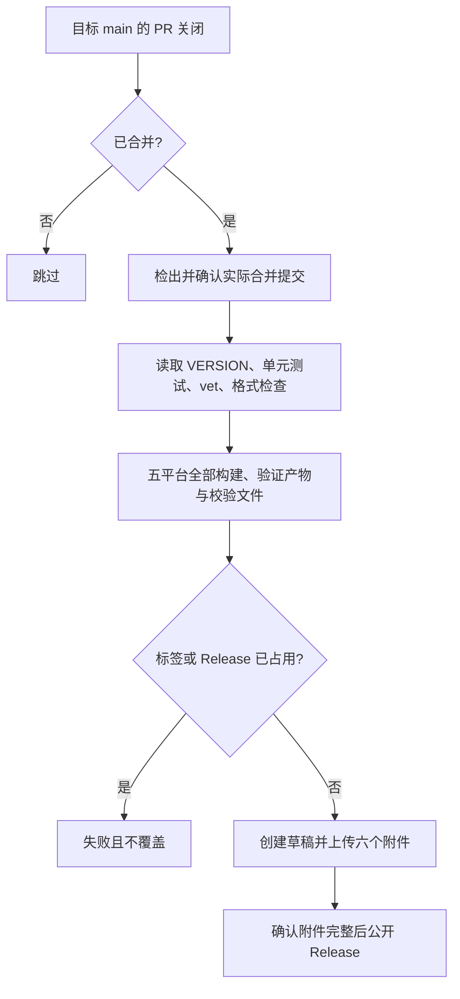

## 目的与触发

- 目的：人工合并 PR 到 main 后，自动分发无需 Go 的五平台可执行文件。
- 实现：[发布工作流](<../.github/workflows/release.yml>)；构建复用[构建脚本](<../.github/scripts/build.sh>)。
- 触发：目标为 `main` 的 PR 关闭事件，仅在 **已合并** 时执行发布 Job。
- 普通 PR、未合并关闭、直接 push、标签 push 都不发布；没有手动发布入口、额外审批或自动合并。
- 使用基线分支上的受信工作流；来自 fork 的 PR 只有合并后才能发布。

## 执行流程与约束

- 单一 Linux x64 Job，30 分钟超时，无 Docker、GoReleaser、额外构建框架。
- 源码是事件中的实际合并 SHA，不使用 PR head 或运行时最新 main；确认检出 SHA 相符且属于 main 历史。兼容 merge、squash、rebase 的最终合并提交。
- 同一 PR 的重复运行串行且不主动取消；不同 PR 不共享单一 pending 槽，避免连续合并丢失触发。
- main 应启用[PR 必需检查](<spec-process-cicd-pr-checks.md#安全与质量门禁>)；合并后仍重新测试实际源码。

## 构建与输出契约

输入：已合并提交、根目录 [VERSION](<../VERSION>)、项目模块依赖和远程版本占用信息。

| 系统 | GOOS | GOARCH | Release 附件 |
| --- | --- | --- | --- |
| macOS Apple Silicon | darwin | arm64 | `skillscli_darwin_arm64` |
| Windows x64 | windows | amd64 | `skillscli_windows_amd64.exe` |
| Windows ARM64 | windows | arm64 | `skillscli_windows_arm64.exe` |
| Linux x64 | linux | amd64 | `skillscli_linux_amd64` |
| Linux ARM64 | linux | arm64 | `skillscli_linux_arm64` |

- 使用 Go 原生编译，禁用 CGO、移除本机构建路径；不支持 macOS Intel，无压缩包。
- 输出目录必须为空；不删除或覆盖本地已有产物。
- 验证每个文件非空、格式及 Go 构建元数据中的 GOOS / GOARCH / CGO；能在构建宿主运行的附件执行 `--help`。
- 第六个附件 `checksums.txt`：恰好五行 SHA-256，使用附件原始文件名，逐项回读校验。
- 发布阶段原生运行 Linux x64；其他发布附件在此阶段为交叉编译，真实平台运行由 PR 原生矩阵验证。

## 版本与发布契约

- 采用 PR 明确更新的版本；[格式与占用规则](<spec-process-cicd-pr-checks.md#版本规则与输入输出>)由 PR 门禁检查，无复杂历史版本计算。
- 发布前再次查询标签和全部分页 Releases，任一占用或查询错误都失败；不覆盖、追加或重复发布已有版本。
- 发布命令自行处理 `v<VERSION>` 标签，并指定实际合并 SHA；没有独立标签管理机制。
- 具有 SemVer 预发布后缀（如 beta、rc）的版本标记为 prerelease；其他为正式版本。
- 所有构建通过后才创建草稿；六个附件上传成功、数量核对通过后公开 Release，自动生成发布说明。
- 输出：指向合并源码的 GitHub Release、六个附件、Actions 摘要链接。

## 安全权限与外部接口

| 项目 | 约束 |
| --- | --- |
| Token | 仅自动提供的 `GITHUB_TOKEN`；工作流默认无权限，发布 Job 仅 `contents: write` |
| 不可信代码 | 未合并 PR 不运行发布 Job；绝不检出未合并 head |
| 凭证 | 不持久化 checkout 凭证，仅查询/发布步骤提供 token；无用户 PAT 或自定义 secrets |
| 依赖与缓存 | 官方 Actions 固定提交；发布不使用构建缓存，使用 runner 自带 Git、Bash、gh 和校验工具 |
| 远程系统 | GitHub Git / Releases API、Go 模块下载；异常按原始日志失败，不静默降级 |

## 失败与验证

| 场景 | 处理 / 恢复 |
| --- | --- |
| SHA 不匹配、不属于 main、测试或构建失败 | 立即停止；不创建 Release |
| 版本已占用（含草稿、仅标签） | 明确失败，不覆盖；成功发布后重跑也会拒绝 |
| Git / API / 上传失败 | 保留原始错误与失败摘要，不公开不完整附件 |
| 创建草稿后失败 | 可能留下草稿或标签；维护者先检查实际状态，确认未发布后人工处理残留，再重跑。流程不自动删除远程对象 |
| 发布已成功但最终状态报告异常 | 先检查实际 Release；不可通过重跑覆盖它 |

验证：静态检查触发与最小权限；合并、未合并关闭、普通 PR 的门控；精确 checkout；项目测试与 vet；五平台文件格式与元数据；清单完整及 SHA-256；CLI 帮助；内联发布保护与上传失败的隔离模拟。首次真实发布只在维护者合并 PR 后执行，不为测试提前发布。

## 维护

变更版本规则、触发或产物时同步更新规范、README 与工作流，在 PR 中验证后人工合并。依托 GitHub Actions 日志、失败通知和摘要观察状态，不额外引入监控、审批或更新系统。相关规范：[PR checks](<spec-process-cicd-pr-checks.md>)。
